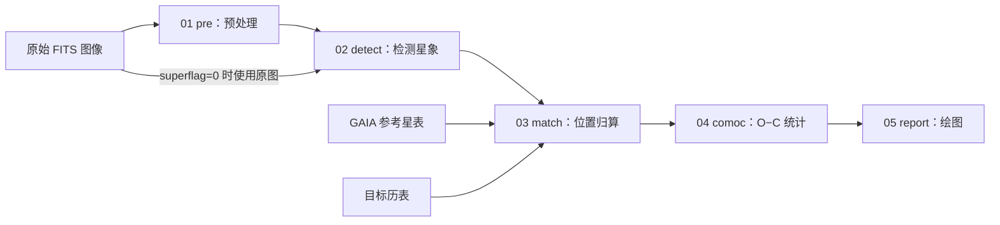
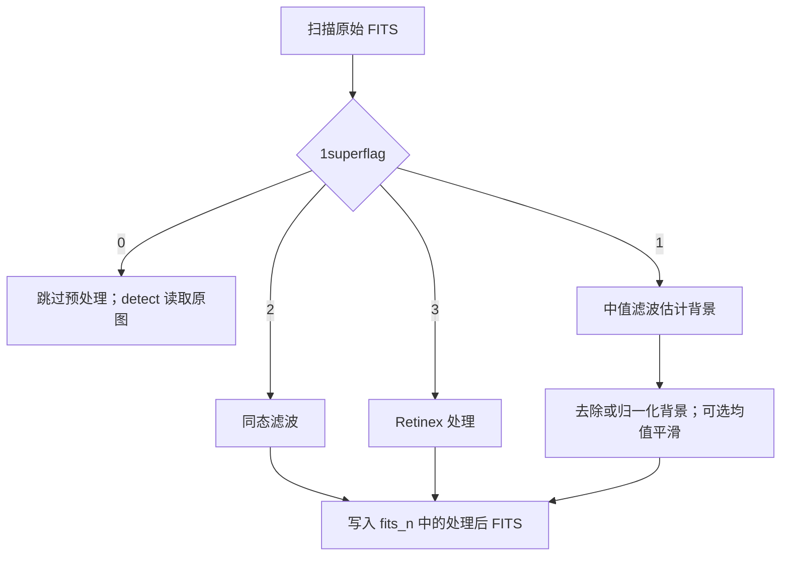
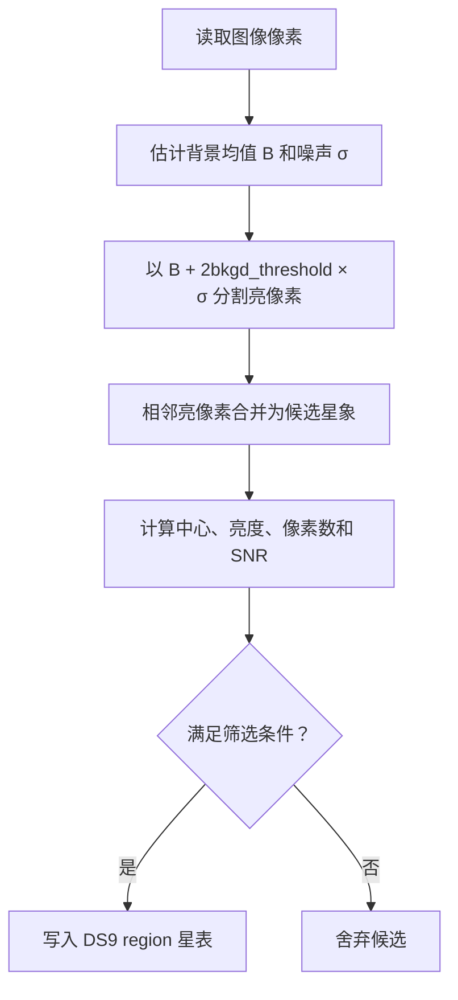
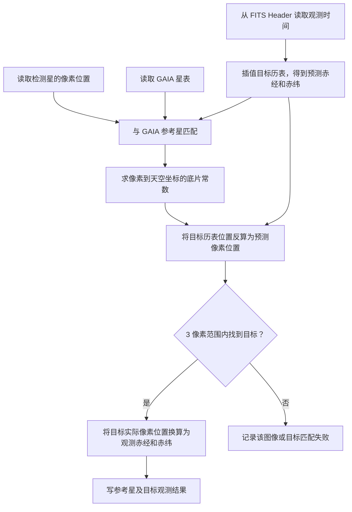
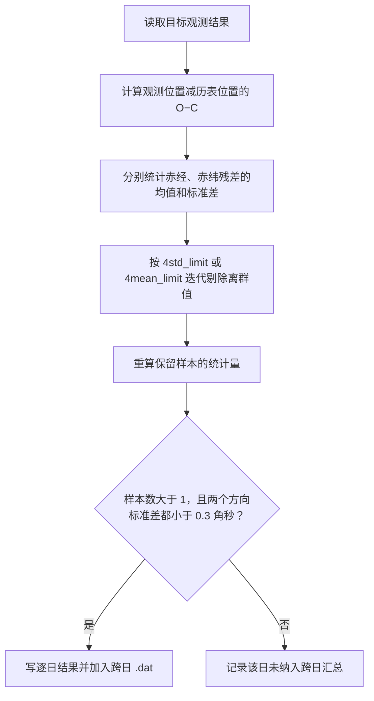
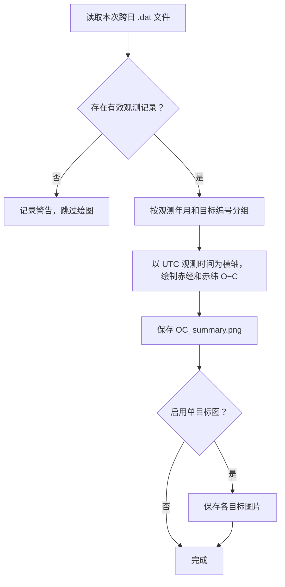

# ADIAS 五阶段流程图

[项目首页](../../README.md) · [文档导航](../../docs/README.md)

本文按当前 Python 程序说明从原始 FITS 图像到 O−C 报告的处理路径。`N` 表示目标编号，`<观测日>` 表示包含 `fits/` 的日期目录。

## 总览

程序先读取并校验配置，将 `1fitspath` 展开为逐日 `fits/` 目录。单独运行某一阶段时，程序不会自动生成前面阶段所需的文件。

## 01 pre：图像预处理

**输入：** `<观测日>/fits/*.fit` 或 `*.fits`。  
**输出：** `<观测日>/fits_n/*_n.fit`。

`1med_length`、`1med_width`、`1bkgdmode`、`1enhance_flag` 主要影响模式 `1`；`1homo_gauss_cutoff` 只影响模式 `2`。重新运行非零预处理模式时，程序会先清理该观测日 `fits_n/` 中旧的 `_n.fit`、`_n.fits` 文件。

## 02 detect：星象检测

**输入：** 预处理后的 FITS；当 `1superflag=0` 时使用原图。  
**输出：** `<观测日>/fits_reg/*.fit.reg` 或 `*.fits.reg`。

`2connectivity` 选择连通域算法，`2pos_method` 控制中心定位的权重，`2snr_threshold` 控制输出筛选，`2detect_workers` 控制文件级并行。此阶段得到的是图像中的像素位置。

## 03 match：参考星匹配与目标位置归算

**输入：** 检测星表、原图 Header、GAIA 参考星表和目标历表。  
**输出：** `<观测日>/fits_ref/*.ref.reg` 与 `<观测日>/fits_out/object_N.out`。

GAIA 星表用于建立图像坐标与天空坐标的对应关系；目标历表给出同一观测时刻的预测位置，也用于寻找图中的目标。`3tele_focal`、`3ccd_scale` 是仪器参数，`3modeltype` 控制底片常数模型，`3match_limit` 控制参考星匹配距离。

## 04 comoc：O−C 统计与离群值剔除

**输入：** 每个观测日的 `fits_out/object_N.out`。  
**输出：** 逐日 `final_*` 文件，以及 `4specified-output` 目录中的跨日 `.dat` 和统计文件。

当 `4std_limit>0` 时，保留数据还须同时满足赤经和赤纬绝对残差均小于 `4eps`。`4del_flag=1` 会删除 `fits_n/`、`fits_reg/`、`fits_ref/` 中的过程文件；`0` 不执行这项清理。

## 05 report：生成 O−C 图

**输入：** 本次 comoc 生成的非空跨日 `.dat`；单独运行 report 时扫描 `4specified-output`。  
**输出：** `OC_summary.png`，以及启用时的单目标 `OC_<历表目标代号>.png`（无法解析代号时使用前缀和编号）。

图中的点表示实测位置与历表预测位置之差随时间的变化。更详细的处理条件和产物说明见[五阶段运行流程详解](NSPA五阶段运行流程详解.md)，参数取值见[配置说明](configuration.md)。
