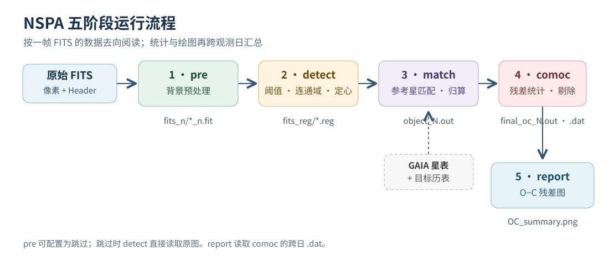
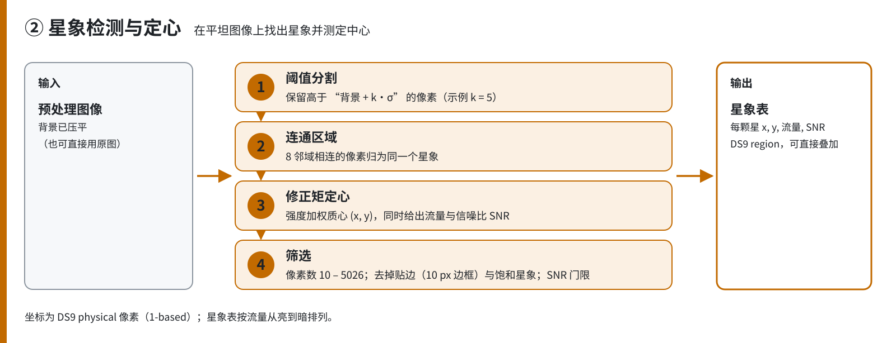
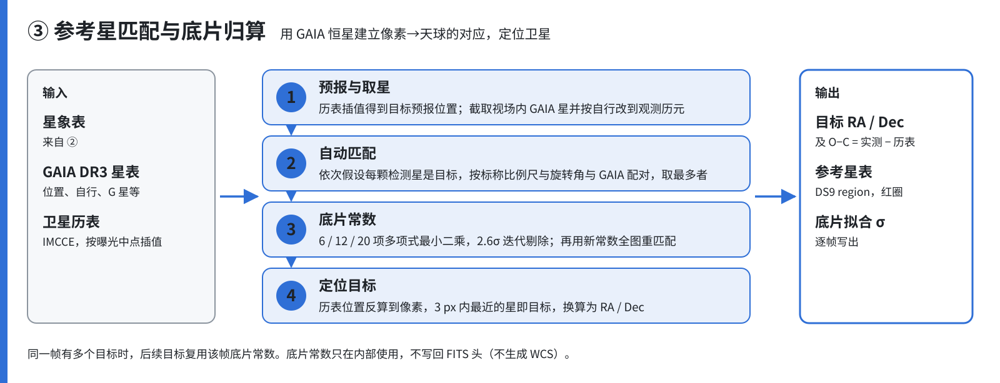

# NSPA（原 ADIAS）五阶段运行流程与关键算法

本文按当前 `nspa/` 源码说明程序如何把原始 CCD FITS 转成目标天体的 O−C 残差图。先看五阶段数据流，再按阶段查处理步骤；阈值、连通域、高斯 PSF、O−C 和时间坐标等概念集中在后面的“关键算法”中。文中的高斯 PSF 是可选定心方法的原理说明，**当前程序实际使用修正矩定心，没有执行高斯 PSF 拟合**。

## 目录

- [总流程与产物](#总流程与产物)
- [1. pre：背景预处理](#1-pre背景预处理)
- [2. detect：检测与定心](#2-detect检测与定心)
- [3. match：参考星匹配与目标定位](#3-match参考星匹配与目标定位)
- [4. comoc：残差统计](#4-comoc残差统计)
- [5. report：绘制残差图](#5-report绘制残差图)
- [关键算法与常见问题](#关键算法与常见问题)
- [运行与核对](#运行与核对)

## 总流程与产物



| 阶段 | 核心输入 | 做什么 | 主要产物 |
| --- | --- | --- | --- |
| `pre` | `fits/*.fit[s]` | 去除或压平背景 | `fits_n/*_n.fit[s]` |
| `detect` | 预处理图，或原图 | 分割亮区、标号、定心和筛选 | `fits_reg/*.fit.reg` |
| `match` | 检测星、原图 Header、GAIA、目标历表 | 建立像素到天球的映射并定位目标 | `fits_ref/*.ref.reg`、`fits_out/object_N.out` |
| `comoc` | `object_N.out` | 计算并筛选 O−C，按日及跨日汇总 | `final_oc_N.out`、跨日 `.dat` |
| `report` | 跨日 `.dat` | 绘制赤经和赤纬残差随时间的变化 | `OC_summary.png`、单目标图 |

`N` 是目标编号；`<日目录>` 是包含 `fits/` 的观测日目录。流水线从配置中的 `1fitspath` 展开观测日，再按顺序执行各阶段。单独运行某阶段时，上游产物须已存在。

## 1. pre：背景预处理

**输入：** `<日目录>/fits/` 中的原始 FITS。原图保留，后续 `match` 仍会读取其 Header。

1. 枚举原始 `.fit` 或 `.fits`，避开已带 `_n` 后缀的处理图。
2. 根据 `1superflag` 选择方法：`0` 跳过；`1` 使用中值滤波估计背景并做除法归一化或减法扣除；`2` 使用同态滤波；`3` 使用双边 Retinex，随后对光照分量做高斯平滑。
3. 估计处理前后的背景与噪声，记录日志，保留 Header，写入 `fits_n/`。例如 `fits/A.fit → fits_n/A_n.fit`。
4. `1superflag=0` 时不生成 `_n` 图；`detect` 直接读原图。

**主要参数：** `1med_length`、`1med_width`、`1bkgdmode`、`1enhance_flag`、`1homo_gauss_cutoff`、`1bssr_gauss_size`。这些是**预处理**选项；Retinex 的高斯平滑并不是第 2 阶段的高斯 PSF 定心。

**运行注意：** 非零预处理模式重跑时，代码会清理 `fits_n/` 中旧的 `_n` 图；本说明只描述行为，不执行该阶段。

## 2. detect：检测与定心



**输入选择：** `1superflag≠0` 时读对应 `fits_n/*_n.fit[s]`；否则读原图。配置要求处理图而文件缺失时，该帧失败，不自动改读原图。

1. 对**每幅图**迭代做 2.6σ 截尾，估计全图背景均值 `B` 和背景标准差 `σ`。
2. 计算阈值 `T=B+kσ`，其中 `k=2bkgd_threshold`。令 `A(x,y)=max[I(x,y)−T,0]`，并清零图像最外一圈。
3. 对 `A>0` 的像素做连通域标号，每个相连亮区成为候选星象。默认 `2connectivity=fortran` 是历史三段式算法；`scipy` 路线使用标准八连通。
4. 在图像内边距区域，对各连通域统计像素数 `n`、阈值以上总强度 `F=ΣAᵢ`，并用修正矩计算中心：`wᵢ=Aᵢ^p`，`p=2pos_method`，`x_c=Σxᵢwᵢ/Σwᵢ`，`y_c=Σyᵢwᵢ/Σwᵢ`。结果使用从 1 开始的像素坐标。
5. 计算 `SNR=F/√(F+nσ²)`；候选按 `F` 从大到小排序。
6. 要求 `10≤n≤⌊π×40²⌋`、`SNR>2snr_threshold` 且没有触发整型 FITS 饱和标志，最后写 `fits_reg/A.fit.reg`。浮点 FITS 不用整型位深做饱和判断。

**这里没有高斯 PSF 拟合。** `2pos_method` 控制修正矩的权重指数，不能把它理解为高斯宽度。细节可另看 [Detect 详细说明](02Detect星象检测详细说明.md)。

## 3. match：参考星匹配与目标定位



**输入：** `fits_reg/*.reg`、原始 FITS Header、GAIA 参考星表、目标历表；`3obj_total` 指定每幅图处理的目标数。

1. 读取曝光时间及望远镜参数，得到用于历表插值的时刻；按星等和视场截取 GAIA 星，并将参考星位置归算到观测历元。
2. **首次求解底片常数时**，把检测星逐个当作“目标可能在这里”的假设。对每个假设，把其余检测星的相对位置投影到天球，与附近 GAIA 星配对，保留匹配数较多的方案。
3. 快路径将 GAIA 参考星投影到切平面并建立 `cKDTree`，批量做半径邻域查询；候选配对再用精确角距检查。快路径异常或匹配不足时回退暴力搜索。因而**仍遍历检测星作为假设**，但不会在每次邻域查询时对全部 GAIA 星逐个做距离比较。
4. 用匹配到的参考星求底片常数，调整求解中心，再对全图检测星重新配对、拟合。底片常数将像素坐标映射到赤经、赤纬；`3modeltype` 选择模型项数，`3match_limit` 限制匹配距离。
5. 用目标历表位置反算预测像素位置，**逐一扫描全部检测星的距离**，只接受预测位置 3 像素范围内最近的一颗，求其观测赤经、赤纬，并与粗匹配结果核对。这里的 3 像素是接受范围；当前实现仍有一次全量线性扫描。
6. 同一幅图的后续目标，在底片常数达到精度和匹配星数条件时复用解；换图后重新求解。

**效率判断：** 最昂贵的是首次建立可靠坐标解。KDTree 缩小了参考星邻域查询量，但每个检测星仍可能成为初始目标假设，检测星过多会增加耗时；最终的 3 像素目标抓取也逐一扫描全部检测星。两处遍历性质不同，应分别计时和改造。

**输出：** `fits_ref/*.ref.reg` 记录参考星，`fits_out/object_N.out` 记录目标观测位置与历表信息。有效检测星或参考星不足、Header/历表缺失、拟合失败时，该帧或目标无法形成有效结果。

## 4. comoc：残差统计

`O−C` 表示 Observed − Calculated，即观测位置减去历表位置。程序分别统计赤经方向和赤纬方向的角秒残差。

1. 按目标、按观测日读取 `fits_out/object_N.out`，计算原始样本数、均值和**样本标准差**。
2. 迭代剔除野值：当 `4std_limit>0` 时，两个方向都需满足相对均值的标准差门限，且残差绝对值小于 `4eps`；当 `4std_limit=0` 时使用 `4mean_limit`。重复计算直到保留数量不再变化。
3. 写逐日 `final_oc_N.out`。只有保留样本数大于 1、且两个方向的标准差都小于 `0.3″`，该日记录才进入跨日 `.dat` 和汇总。
4. `4specified-output` 控制跨日汇总目录。若 `4del_flag=1`，代码会删除 `fits_n/`、`fits_reg/`、`fits_ref/` 中的过程文件；需要保留中间产物时设为 `0`。

**补充：** `object_N.out` 写出前还会舍弃任一方向绝对残差达到 `10″` 的记录。逐日输出文本中有列名写成“方差”，其数值按源码实际为开方后的**标准差**。

## 5. report：绘制残差图

1. 完整流水线只读取本次 comoc 生成的非空 `.dat`；单独运行 report 才扫描 `4specified-output`。按历表目标代号和观测年月组织记录。
2. 将赤经、赤纬 O−C 分别放在左右子图，横轴为含日内小数的 UTC 日期；不同目标用不同颜色。
3. 保存 `OC_summary.png`；开启单目标绘图时，另存各目标图。没有有效记录则记录警告，不产生对应图像。

## 关键算法与常见问题

### A. 检测阈值怎样设？概率含义是什么？

代码每幅图单独估计 `B`、`σ`，再用 `T=B+kσ`，并非所有图统一使用固定像素值。例：`B=700`、`σ=8`、`k=3.5`，则 `T=728`；像素 `760` 的阈值以上强度为 `32`，像素 `720` 被归零。提高 `k` 会减少弱噪声误检，也可能漏掉暗目标。`2snr_threshold` 是**整颗候选星象**的后续筛选门槛，和单像素阈值不同。

若纯背景像素近似服从正态分布，则 `Z=(I−B)/σ` 近似为标准正态变量，单个背景像素越过阈值的概率是 `P(Z>k)=1−Φ(k)`。例如 `k=3.5` 约为 `2.3×10⁻⁴`，`k=5` 约为 `2.9×10⁻⁷`。这是**单像素理想模型**，不是程序最终的误检率；实际噪声、像素相关性、连通域筛选和 SNR 均会改变结果。[Astropy sigma clipping 文档](https://docs.astropy.org/en/stable/api/astropy.stats.sigma_clip.html)解释了截尾估计方法。

### B. 连通域如何形成一颗候选星？

阈值只区分前景与背景。连通域再沿像素邻接关系给相连的前景像素同一个标签。四连通看上下左右；八连通还看四个对角。例如对角相接的两个像素，四连通得到两组，八连通得到一组。`scipy` 路线是[标准八连通标号](https://docs.scipy.org/doc/scipy/reference/generated/scipy.ndimage.generate_binary_structure.html)；默认 `fortran` 路线保留历史实现，复杂形状下未必与标准算法逐项一致。连通域是**候选**，相邻双星可能合并，噪声簇也可能成域，仍要通过像素数、SNR 等检查。

### C. 修正矩与高斯 PSF 怎样求星象中心？

**当前方法：修正矩。** 对某个连通域，设阈值以上强度为 `Aᵢ`，像素坐标为 `(xᵢ,yᵢ)`，配置指数为 `p`：

```text
wᵢ = Aᵢ^p
x_c = Σ(xᵢ wᵢ) / Σwᵢ
y_c = Σ(yᵢ wᵢ) / Σwᵢ
F   = ΣAᵢ
```

`p=1` 是强度加权中心；`p=2` 或 `3` 更重视亮核。更高权重也会让饱和、宇宙线或非对称亮核对中心产生更大影响。

**高斯 PSF 定心：一种未接入当前程序的模型拟合法。** 对近似圆对称星象，可写成：

```text
I(x,y) ≈ B + A · exp{ -[(x−x₀)²+(y−y₀)²]/(2s²) }
```

`B` 是局部背景，`A` 是峰值振幅，`(x₀,y₀)` 是中心，`s` 是宽度；`FWHM≈2.355s`。椭圆模型可分别拟合 `sₓ`、`sᵧ`，必要时增加旋转角。实际操作是：截取孤立星附近小窗口 → 估计局部背景与初始中心 → 拟合 `B,A,x₀,y₀,sₓ,sᵧ` → 检查残差和参数合理性 → 接受中心或标记失败。拟合使用窗口内多个像素的二维形状，而不是仅取最亮像素。[Astropy Gaussian2D](https://docs.astropy.org/en/stable/api/astropy.modeling.functional_models.Gaussian2D.html)给出模型形式，[Photutils 二维高斯定心](https://photutils.readthedocs.io/en/stable/api/photutils.centroids.centroid_2dg.html)给出实际接口。

**一维简化算例：** 假设已经减去背景，真实中心 `x₀=10.3` 像素、`s=1` 像素、`A=100`。模型在 `x=9,10,11` 给出的强度约为 `42.96,95.60,78.27`。在已知 `s` 且数据恰好符合模型时，由两侧像素之比可反推：

```text
x₀ = 10 + (s²/2) ln[I(11)/I(9)]
   = 10 + 0.5 ln(78.27/42.96)
   ≈ 10.30 像素
```

真实图像要同时拟合背景、中心和宽度，不能仅用这三个像素的公式。高斯拟合适合形状近似高斯、未严重饱和且较孤立的星象；拖尾、混叠、饱和时应检查拟合残差。当前代码没有执行这些步骤，`2pos_method` 仍是修正矩指数。

### D. O−C 的均值、标准差分别说明什么？

程序以角秒表示：

```text
r_RA  = (观测赤经 − 历表赤经) × 3600 × cos(历表赤纬)
r_Dec = (观测赤纬 − 历表赤纬) × 3600
均值  r̄ = Σrᵢ/n
样本标准差 s = √[Σ(rᵢ−r̄)²/(n−1)]，n≥2
```

赤经与赤纬在前两式中以**度**为单位；余弦项将赤经坐标差换算为该赤纬处的东西向角距离。均值描述整体偏正或偏负，标准差描述数据围绕均值的离散程度。例如 `+0.2″、+0.4″、+0.6″` 的均值为 `+0.4″`，样本标准差为 `0.2″`：三次观测较集中，但整体仍偏正。标准误 `s/√n` 是另一种量，不等于本程序报告的标准差。

### E. UTC、北京时间与曝光中点

北京时间（中国标准时间）=`UTC+8 小时`。例如北京时间 `2026-10-01 00:30` 是 UTC `2026-09-30 16:30`，日期也会改变。[中国政府网关于标准时间的说明](https://app.www.gov.cn/govdata/gov/202504/26/527808/article.html)。

程序从原始 FITS Header 取曝光开始时刻，加 `EXPTIME/2` 得曝光中点；根据 `3tele_label` 的设备约定解释时间：`ss156`、`ss156_2014` 会减 8 小时，其余支持的标签没有这一步。程序不会自动从字符串识别时区；Header 的时间标准必须和设备配置相符。`3delta_T` 还会对归算时刻作秒级修正。

### F. 为什么赤经用时分秒，赤纬有正负？

赤经是天球上的角坐标，并非当前钟表时间。一圈 `24h=360°`，所以 `1h=15°`；时分秒是角度的传统记法。[美国海军天文台赤经换算说明](https://aa.usno.navy.mil/faq/sun_approx)。

赤纬是天体相对天赤道的南北角距离：天赤道 `0°`、北天为正、南天为负，范围 `−90°…+90°`。因此常写成带正负号的度、角分、角秒。例如 `−12°30′` 表示南侧 `12.5°`。[美国海军天文台术语表](https://aa.usno.navy.mil/faq/asa_glossary)。

## 运行与核对

从仓库根目录执行；此处用仓库中存在的 `inputs/configs/nspa.cfg` 举例。运行前应确认其中的观测路径、星表路径和输出目录指向要处理的数据。

```powershell
python -m nspa.main --config inputs/configs/nspa.cfg --step all
```

只绘图时（需已有跨日 `.dat`）：

```powershell
python -m nspa.main --config inputs/configs/nspa.cfg --step report
```

| 看到的问题 | 首先检查 |
| --- | --- |
| 没有预处理图 | `1superflag`、`<日目录>/fits_n/` |
| 没有检测星 | `2bkgd_threshold`、`2snr_threshold`、`fits_reg/*.reg` |
| 没有目标结果 | 原图 Header、GAIA/历表路径、`fits_ref/`、`object_N.out` |
| 没有跨日数据 | `final_oc_N.out` 的保留数和双方向标准差 |
| 没有图 | `4specified-output` 下是否有非空 `.dat` |

每次流水线执行会在配置的 `run_manifest_dir`（默认 `outputs/runs`）下生成本次 `manifest.json`，记录步骤、输出、警告和失败项。

**对应源码：** [入口](../../nspa/main.py)、[检测算法](../../nspa/utils/image_utils.py)、[匹配算法](../../nspa/domain/matching.py)、[O−C 统计](../../nspa/core/analyzer.py)、[配置](../../nspa/config.py)。
